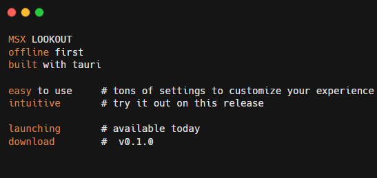
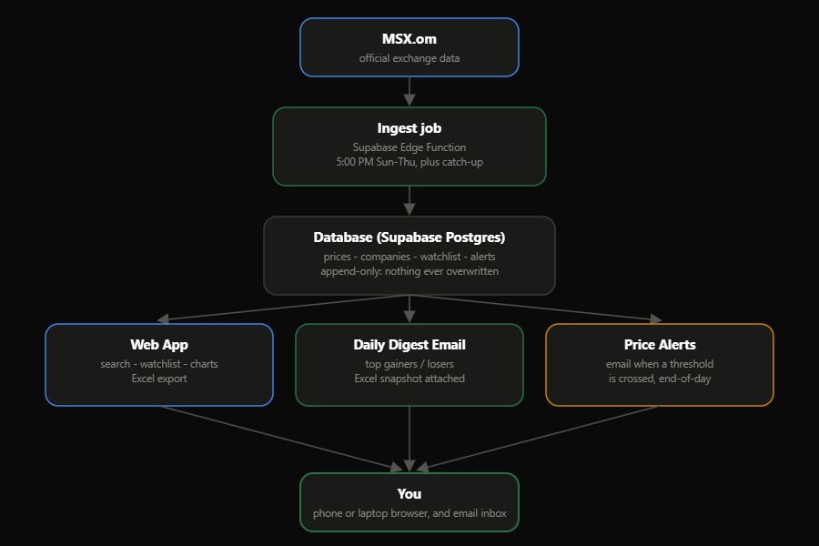
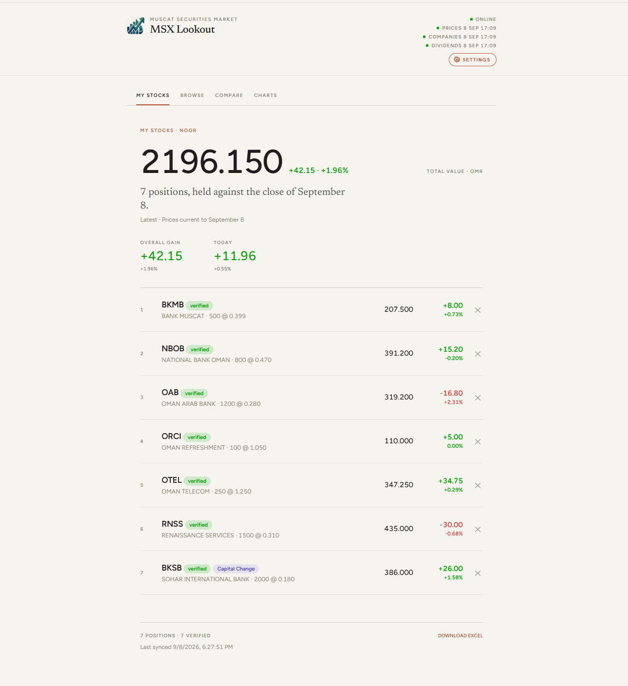

# MSX Lookout

Track Muscat Stock Exchange (MSX) prices on your machine: watchlist, charts, alerts, daily digests. Read the market without an account; change shared data or kick ingest with an operator key in Settings.

Tauri (Windows) · static web client · Supabase



## Quickstart

Grab the latest Windows build from Releases. The desktop app checks GitHub for updates and can pull a newer build when one is out, so you are not stuck on whatever version this README was written against.

Install or run it. Same UI as the static page (`web/index.html`); browse prices and charts with no login.

Optional: open Settings, drop in your operator key (same as the server ingest secret) if you want to edit the shared watchlist, email prefs, or trigger updates.

That's it.

Sunday through Thursday, after MSX closes, ingest runs and history piles up (nothing overwritten). Alerts and the daily summary email are optional; leave the address blank if you do not want mail.

## How it works



One Supabase project holds prices, companies, watchlist, alerts. Scheduled Edge Functions handle ingest, digest, alerts, company refresh, weekly backup. The static site can live on GitHub Pages; email goes through Resend when you configure it.

Announcements (splits, dividends, listings) get filed against the right ticker. Roughly two years of MSX history from mid-2024 onward is already in the dataset so older positions are not blank slates.

## The app

One web page is the front door. My stocks is your watchlist. Browse is every listed name (filter, sectors, flags for quiet or liquidation names). Click a stock to log a position; it sanity-checks your buy price against history but does not block you.



Charts: candles or area, volume, drawing tools, compare two periods. Settings: theme, refresh cadence, email toggles:

```
1 - all email notifications
2 - new listings and delistings
3 - update failure alerts
```

MSX down? Last confirmed price stays visible with a timestamp. Offline mode keeps the last good pull on disk; writes queue until you are back online.

## Build from source

Until an installer is on Releases, `cargo tauri dev` opens the window. Expect rough edges; open an issue if something snaps.

Works today. Issues and PRs welcome; say what you changed in the PR.
